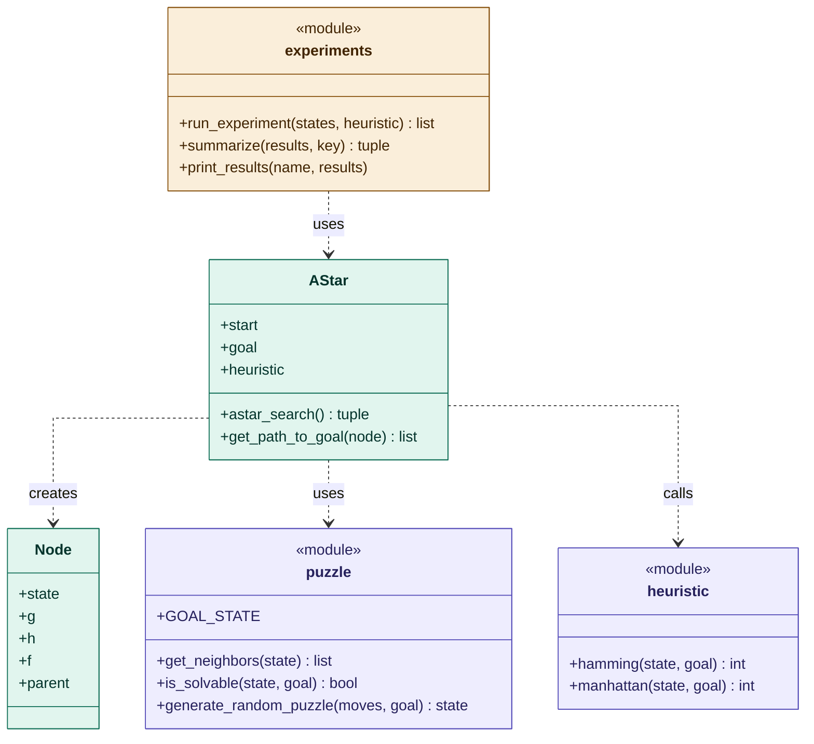

# 8-Puzzle: A* Search with Hamming and Manhattan

## 1. Task description

## 2. Software architecture

The program is split into four modules. Each module has one job, and the dependencies only go in one direction:

- `experiments.py` runs the measurements and uses all other modules.
- `astar.py` contains the search. It only uses `puzzle.py` to get the next states.
- `puzzle.py` and `heuristic.py` contain the puzzle rules and the heuristics. They do not depend on any other module.

The heuristic is not imported by `astar.py`. Instead it is passed to the `AStar` class as a parameter, so A* works with any heuristic of the form `heuristic(state, goal)`.




## 3. Modules and interfaces

### puzzle.py
The `puzzle.py` module implements the basic functionality of the 8-Puzzle, including the puzzle representation, valid moves, solvability checks and random puzzle generation.

The puzzle is represented as a 3×3 tuple of tuples containing the numbers 0–8, where `0` represents the empty space.

**Main functions:**

* `is_goal(state, goal)`: Checks whether the current puzzle state matches the goal state. Returns `True` or `False`.
* `find_blank(state)`: Finds the position of the empty tile and returns its row and column.
* `get_neighbors(state)`: Generates all possible next states by moving the empty tile up, down, left or right, depending on its position.
* `create_new_states(state)`: Calls `get_neighbors()` to provide the neighboring states for the A* algorithm.
* `inversion_count(state)`: Counts the number of inversions, meaning pairs of numbered tiles that appear in the wrong order.
* `is_solvable(state, goal)`: Checks whether the puzzle can reach the goal state by comparing the parity of their inversion counts.
* `generate_random_puzzle(moves, goal)`: Generates a solvable puzzle by performing random valid moves starting from the goal state.

**Computational complexity:**

Most functions operate on the fixed 3×3 board and therefore have constant time complexity, O(1). The inversion counting algorithm compares pairs of the eight numbered tiles, requiring O(n²) time for n numbered tiles.

The random puzzle generator requires O(m) time, where m is the number of random moves.

### heuristic.py
The `heuristic.py` module implements two admissible heuristic functions used by the A* search algorithm to estimate the remaining cost of reaching the goal state.

### Hamming Distance

The function `hamming(state, goal)` counts the number of numbered tiles that are not in their correct goal positions.

The empty tile (`0`) is excluded from the calculation.

The function returns an integer representing the number of misplaced tiles.

### Manhattan Distance

The function `manhattan(state, goal)` calculates the sum of the horizontal and vertical distances between each numbered tile's current position and its correct position in the goal state.

For each tile, the distance is calculated as:

**Distance = |current_row − goal_row| + |current_col − goal_col|**

The empty tile is excluded from the calculation.

The function returns the total Manhattan distance as an integer.

### Comparison

Both heuristics are admissible because they never overestimate the actual number of moves required to solve the puzzle.

Manhattan Distance provides a more informative estimate than Hamming Distance because it considers how far each tile needs to move instead of only checking whether it is misplaced.

**Computational complexity:**

Both functions examine the nine positions of the puzzle. Therefore, their time complexity is O(1) for the fixed-size 8-Puzzle.

### astar.py
This module contains the A* search. It looks for the shortest way from a start state to the goal state.

A* always continues with the node that looks cheapest. For every node it calculates **f(n) = g(n) + h(n)**: g(n) is the number of moves already made, h(n) is the estimate from the heuristic for the moves still missing.

**Main classes and functions:**

* `Node`: One node in the search tree. Stores the state, g, h, f and the parent node.
* `AStar(start_state, goal_state, heuristic)`: Holds the start state, the goal state and the heuristic to use.
* `find_lowest_cost_node(nodes_to_explore)`: Takes the node with the lowest f out of the open list.
* `astar_search()`: Runs the search and returns the path, the number of expanded nodes and the number of created nodes.
* `get_path_to_goal(node)`: Goes back from the goal to the start using the parent nodes.
* `print_puzzle(state)`: Prints a state as a 3×3 grid.

**The search loop:**

```python
while open_list:
    current = find_lowest_cost_node(open_list)

    if current.state == self.goal:
        return self.get_path_to_goal(current), nodes_expanded, nodes_created

    if current.state in closed_list:
        continue
    closed_list.add(current.state)
    nodes_expanded += 1

    for new_state in get_neighbors(current.state):
        if new_state not in closed_list:
            g = current.g + 1
            h = self.heuristic(new_state, self.goal)
            open_list.append(Node(new_state, g, h, current))
            nodes_created += 1
```

In every round we take the node with the lowest f. If it is the goal, we are done. If we already explored this state, we skip it. Otherwise we add it to the closed list and create a new node for every neighbor, one move further than its parent.

**Computational complexity:**

The more moves a puzzle needs, the more nodes A* creates. In the worst case this grows exponentially, O(b^d), where b is the number of possible moves per state and d is the number of moves in the solution.

Our open list is a normal list, so we have to go through the whole list every time we look for the lowest f. Because of that, twice as many nodes means about four times the runtime, O(N²).

### experiments.py
This module compares Hamming and Manhattan. It solves the same 100 random puzzles with both heuristics and prints the results.

We use a fixed random seed, so every run creates the same puzzles and the results can be reproduced.

**Main functions:**

* `run_experiment(states, heuristic_function)`: Solves every puzzle with A* and saves the number of moves, expanded nodes, created nodes and the runtime.
* `summarize(results, key)`: Calculates mean, variance and standard deviation for one value.
* `print_results(name, results)`: Prints the results for one heuristic.

The runtime is measured with `time.perf_counter()` right before and after `astar_search()`, so only the search itself is measured. Both heuristics get exactly the same 100 puzzles, so the comparison is fair.

**Computational complexity:**

Almost all of the runtime comes from the 200 A* searches. Calculating the statistics at the end is fast in comparison.

## 4. Design decisions

### puzzle.py and heuristic.py
### Puzzle Representation

We chose to represent the puzzle using tuples of tuples because tuples are immutable and hashable.

This allows puzzle states to be stored in sets, which is useful for tracking previously explored states in the A* search algorithm.

The empty tile is represented by `0`, making it easy to identify its position and calculate valid moves.

### Solvability Check

For the 3×3 puzzle, solvability is determined using inversion parity.

Two states are mutually reachable if their inversion counts have the same parity (both even or both odd).

This check prevents the algorithm from attempting to solve impossible puzzle configurations.

### Random Puzzle Generation

Random solvable puzzles are generated by starting from the goal state and performing valid random moves.

This approach ensures that every generated puzzle is solvable.

### Heuristic Selection

We implemented Hamming Distance and Manhattan Distance as required by the assignment.

Both heuristics are admissible, allowing A* to find an optimal solution when the search is implemented correctly.

Manhattan Distance is generally more informative because it considers the distance each tile must travel.

Using both heuristics allows us to compare their influence on the search algorithm's runtime and memory requirements.

### A* and experiments

#### A* as a Class

We implemented A* as a class `AStar` that gets the start state, the goal state and the heuristic. The heuristic is passed as a parameter instead of being imported. This way the same search works with Hamming and Manhattan without changing the A* code.

#### Open List and Closed List

The open list is a normal Python list. We chose it because it is easy to understand and to debug. The downside is that finding the node with the lowest f takes longer the bigger the list gets (see Possible improvements).

The closed list is a set, because checking whether a state was already explored is very fast in a set. This works because the puzzle states are tuples (see Puzzle Representation).

#### Parent Links

Every node stores the node it was created from. When the goal is found, we follow these links back to the start to get the full solution path.

#### Counting Nodes

We count both expanded nodes and created nodes. The task asks for the "number of tree nodes", and with both values we cover both possible meanings.

#### Fair Comparison

Both heuristics solve exactly the same 100 puzzles. We use a fixed random seed, so every run creates the same puzzles and the results can be checked again. The runtime is measured only around the search itself with `time.perf_counter()`.

## 5. Discussion and conclusions

### Experience

### Results

### Possible improvements
